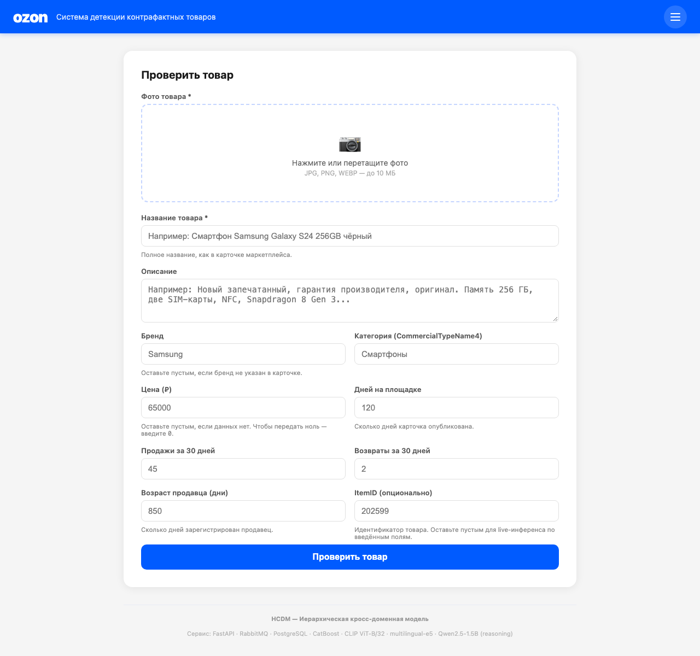
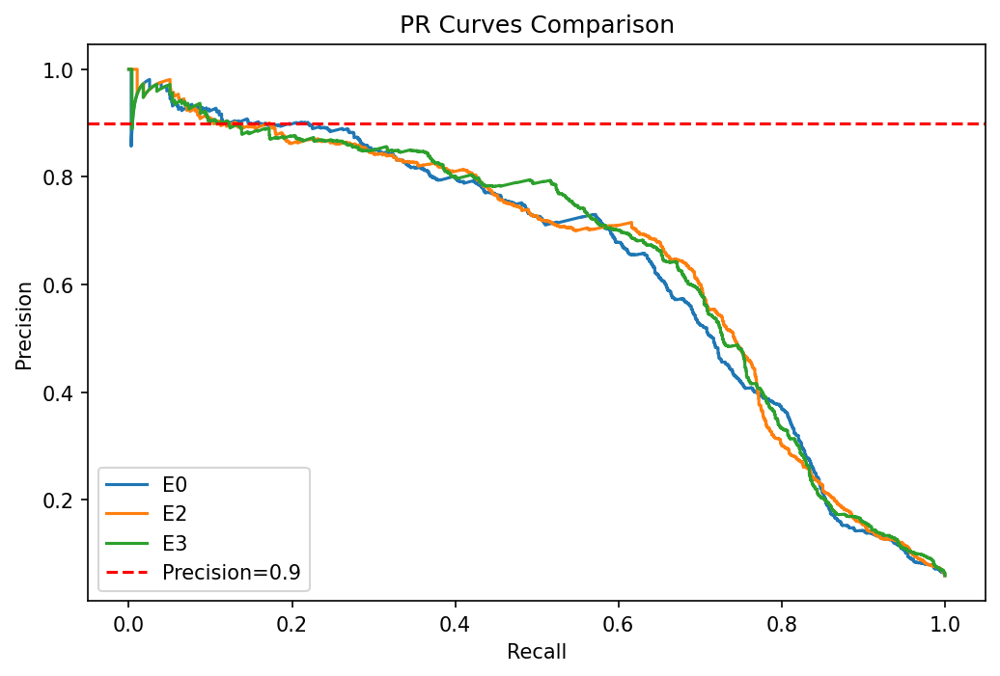

# Детекция контрафакта на Ozon: кросс-доменная модель HCDM

Магистерская ВКР (НИУ ВШЭ, ФКН, 2025–2026): система, которая оценивает риск контрафакта по карточке товара на маркетплейсе и помогает модерации разбирать очередь в правильном порядке. Методы для неё перенесены из четырёх соседних областей, где тоже ищут подделки: соцсети, мобильные приложения, недвижимость и финтех.

**Это витрина моей части проекта.** Полный код, ноутбуки и сервис лежат в командном репозитории:
👉 **[dianamkoian/master-thesis-2025](https://github.com/dianamkoian/master-thesis-2025)**




---

## Моя роль

**Красовская Софья**: финтех-домен, веб-интерфейс, контейнеризация и деплой сервиса.

- **Финтех-канал модели.** Серия экспериментов E0–E7: перенос приёмов из детекции банковского фрода (подбор порога, балансировка классов, калибровка, deviation-признаки продавца) и проверка, где на самом деле узкое место.
- **Веб-интерфейс.** Одностраничное приложение на чистом JavaScript: форма проверки карточки, страница метрик, схема архитектуры.
- **Деплой.** Docker Compose (API, воркер, RabbitMQ, PostgreSQL), развёртывание на VPS с HTTPS.

## Команда

| Участник | Домен | Часть сервиса |
| --- | --- | --- |
| Азимова Карина | Мобильные приложения и реклама | REST API (FastAPI) |
| Бахтиарова Альбина | Социальные сети | Хранилище (PostgreSQL) |
| Мкоян Диана | Недвижимость | Брокер сообщений (RabbitMQ), тестирование |
| **Красовская Софья** | **Финтех** | **Веб-интерфейс, Docker, деплой** |

Научный руководитель: Быков Кирилл Валерьевич.

---

## Результат команды

Итоговая модель HCDM на датасете [Ozon E-CUP 2025](https://www.kaggle.com/datasets/islomka/ozon-ecup-2025-images-test), разбиение по продавцам (ни один продавец не попадает одновременно в train и test), n_test = 58 410:

| Метрика | Baseline CatBoost | **HCDM** |
| --- | --- | --- |
| ROC-AUC | 0,9051 | **0,9492** |
| PR-AUC | 0,6231 | **0,8044** |
| Recall @ Precision ≥ 0,9 | 0,0145 | **0,2068** |

HCDM складывает прогнозы четырёх доменных моделей с фиксированными весами:

```
p_HCDM = 0,875·p_social + 0,075·p_mobile + 0,025·p_realestate + 0,025·p_fintech
```

Финтех-канал весит немного, но работает как диверсификатор: его ошибки слабо совпадают с ошибками остальных каналов. Ablation study показывает, что без любого из четырёх каналов качество падает.

---

## Финтех-блок: что я проверяла

Контрафакт на маркетплейсе похож на банковский фрод: редкое событие (контрафакт меньше 8% карточек), сильный дисбаланс классов и дорогая ошибка, если заблокировать честного продавца. Поэтому главная метрика здесь **Recall при Precision ≥ 0,9**: какую долю контрафакта модель ловит, почти не задевая честных продавцов.

Я переносила методологию, а не данные: транзакций в датасете нет, есть поведенческие агрегаты продавца (продажи, возвраты, возраст аккаунта).

| Гипотеза | Что пробовали | Итог |
| --- | --- | --- |
| H1. Дело в пороге решения | Подбор порога, вес позитивного класса | ❌ Recall в целевой зоне не растёт |
| H2. Дело в обработке признаков | Undersampling + калибровка, deviation-признаки продавца, TF-IDF | ❌ PR-AUC чуть выше, но в зоне precision 0,9 изменений нет |
| H3. Не хватает новой модальности | Эмбеддинги изображений (CLIP) и текста (e5-small), сжатые PCA до 25 компонент | ✅ Recall @ P ≥ 0,9 вырос с 0,17 до 0,30–0,33, значимо по бутстрапу |

**Главный вывод:** потолок задают признаки, а не метод. Приёмы из финтеха улучшают модель в средней зоне, но в зоне высокой точности упираются в то, что у табличных признаков нет нужной информации. Пробивает этот потолок только новая модальность. Это и стало аргументом за мультимодальную HCDM.



*Финтех-приёмы (E2, E3) почти не двигают кривую в зоне precision ≥ 0,9 (красная линия).*

Ещё одна находка: при случайном разбиении Recall @ P ≥ 0,9 завышается в 3,7 раза, потому что модель запоминает продавца. Поэтому все оценки в работе сделаны на разбиении по продавцам.

Подробности, таблица E0–E7 и бутстрап-интервалы: [fintech_approaches](https://github.com/dianamkoian/master-thesis-2025/tree/main/fintech_approaches).

---

## Как устроен сервис

```
Веб-интерфейс ──► FastAPI ──► RabbitMQ ──► Воркер (модель HCDM) ──► PostgreSQL
                     │                                                  │
                     └────────── результат по task_id ◄─────────────────┘
```

- `POST /predict`: принять карточку товара и получить оценку риска
- `GET /result/{task_id}`: забрать результат асинхронной проверки
- `POST /feedback/{prediction_id}`: обратная связь модератора

Скор делит поток на зоны: высокий риск идёт на приоритетную проверку, средний попадает в очередь модератора, низкий пропускается. Окончательное решение принимает модерация, модель только расставляет приоритеты.

Стек модели: CatBoost, CLIP ViT-B/32, multilingual-e5, Qwen2.5-1.5B для текстового объяснения решения.

Код сервиса: [counterfeit_service](https://github.com/dianamkoian/master-thesis-2025/tree/main/counterfeit_service).

---

## Что в этом репозитории

```
.
├── app.py              # короткая страница о проекте на Streamlit
├── requirements.txt
└── docs/               # картинки для README
```

Запустить страницу о проекте локально:

```bash
pip install -r requirements.txt
streamlit run app.py
```
